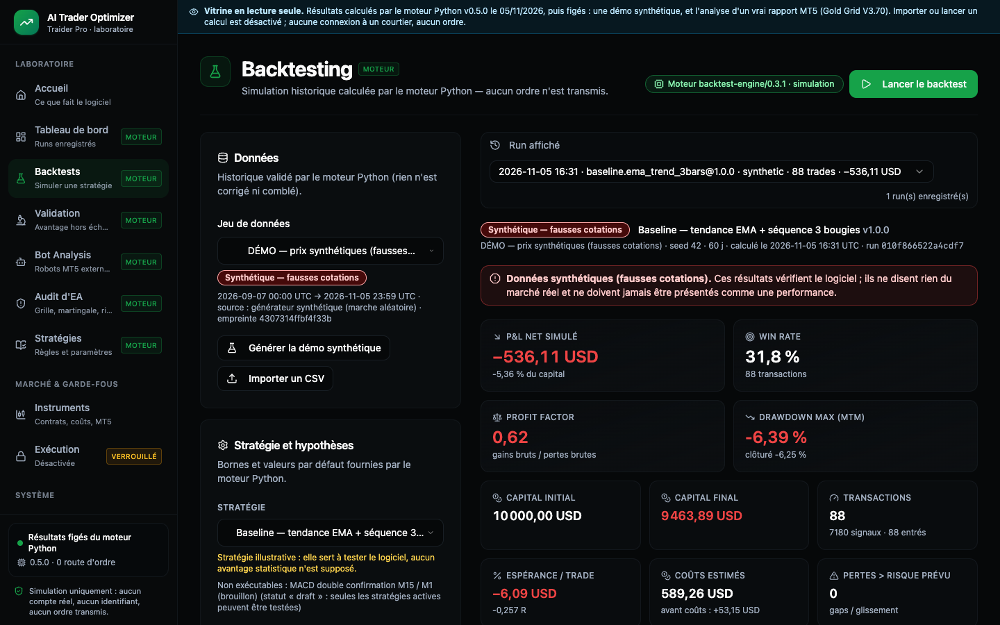
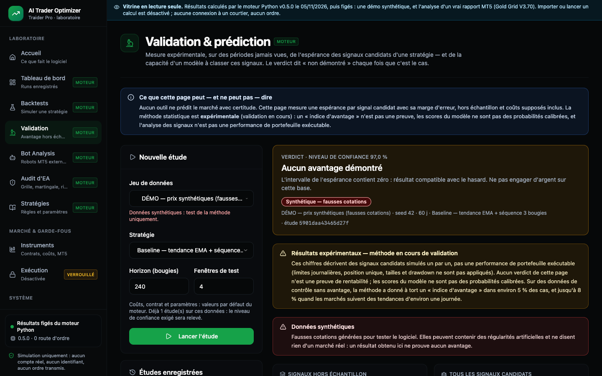
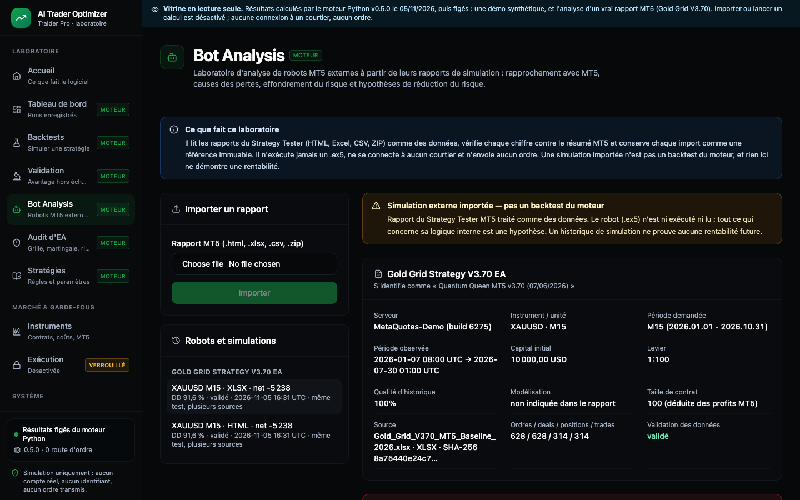
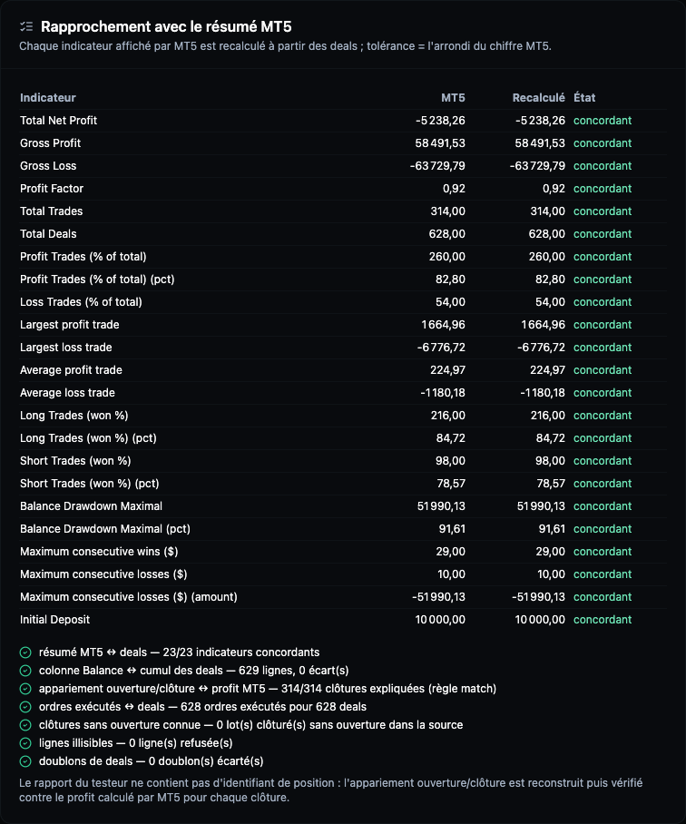
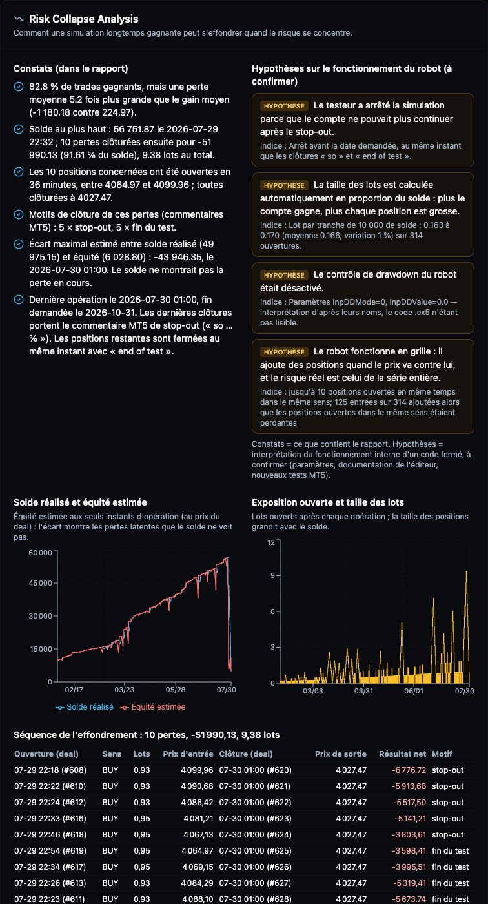
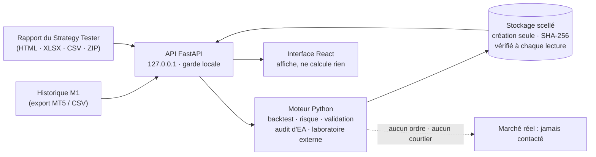

# Traider Pro — AI Trader Optimizer

**Le laboratoire qui teste une idée de trading sur l'or (XAUUSD) et le Forex _avant_ d'y risquer un centime.**
Il simule, vérifie et explique. Il ne promet pas de gains.


## Sommaire
- [Pourquoi ce projet](#pourquoi-ce-projet)
- [Ce que fait la plateforme](#ce-que-fait-la-plateforme)
- [Cas réel : un robot qui gagne 82,8 % du temps… puis perd tout](#cas-réel--un-robot-qui-gagne-828--du-temps-puis-perd-tout)
- [Comment ça marche](#comment-ça-marche)
- [Principes de conception](#principes-de-conception)
- [Démarrer](#démarrer)
- [Vitrine en ligne](#vitrine-en-ligne)
- [Fiabilité : ce qui est vérifié, et ce qui ne l'est pas](#fiabilité--ce-qui-est-vérifié-et-ce-qui-ne-lest-pas)
- [Feuille de route](#feuille-de-route)
- [Documentation](#documentation)
- [Licence et avertissement](#licence-et-avertissement)

## Pourquoi ce projet

La plupart des backtests mentent sans le vouloir :
- le futur fuit dans le passé ;
- les coûts sont oubliés ;
- un rapport « 82 % de trades gagnants » cache le risque qui finira par vider le compte.

Traider Pro prend le parti inverse :
- **chaque chiffre est recalculable** ;
- **chaque refus est expliqué** ;
- **chaque méthode statistique a été testée** sur des données dont on connaît la réponse.

Quand il ne sait pas, il le dit (« échantillon insuffisant », « hypothèse », « non simulable »).

## Ce que fait la plateforme

| Page | Ce qu'elle apporte |
|---|---|
| **Backtests** | Rejoue une stratégie bougie par bougie sur un historique M1 (export MT5 ou CSV), avec spread, glissement, commissions et un **Risk Guardian** qui refuse les trades hors limites. Chaque run est **scellé** (SHA-256) et peut être « reproduit » à l'identique. |
| **Validation** | Mesure si les signaux d'une stratégie gardent une espérance positive **sur des périodes jamais vues** : walk-forward purgé, filtre logistique, bootstrap par grappes, registre infalsifiable des essais multiples. Méthode **expérimentale**, éprouvée par une campagne statistique pré-enregistrée. |
| **Bot Analysis** | Analyse un robot MT5 externe dont on n'a que le `.ex5`, à partir de son **rapport du Strategy Tester** (HTML, Excel, CSV, ZIP). Le rapport est rapproché indicateur par indicateur ; ordres, deals, positions et trades sont reconstruits. La page montre ensuite **comment le compte s'effondre** et teste des règles de réduction du risque, chacune qualifiée. |
| **Audit d'EA** | Repère grille, martingale, positions empilées et stop-out, puis chiffre **le mouvement de l'or qui viderait le compte** au pire moment. |
| **Stratégies, Instruments, Paramètres** | Règles versionnées, contrat XAUUSD (hypothèse déclarée), profil de risque. |
| **Exécution** | Volontairement **verrouillée** : aucun ordre, réel ou démo. |

<table>
<tr>
<td width="50%"><br><sub><b>Backtests</b> — résultats, coûts, refus du Risk Guardian, traçabilité.</sub></td>
<td width="50%"><br><sub><b>Validation</b> — verdict hors échantillon, marqué expérimental.</sub></td>
</tr>
<tr>
<td width="50%"><br><sub><b>Bot Analysis</b> — un rapport MT5 importé, vérifié et conservé comme référence immuable.</sub></td>
<td width="50%"><br><sub><b>Rapprochement</b> — chaque indicateur MT5 recalculé à partir des transactions.</sub></td>
</tr>
</table>

## Cas réel : un robot qui gagne 82,8 % du temps… puis perd tout

Le robot commercial « Gold Grid Strategy V3.70 EA » (« Quantum Queen MT5 ») a été testé dans le Strategy Tester MT5 :
XAUUSD M15, 10 000 USD, du 01/01 au 31/10/2026. La plateforme a importé son rapport, puis :

- **recalculé les 23 indicateurs de MT5** à partir des transactions, à l'identique (résultat net −5 238,26 USD,
  314 trades) ;
- **rattaché les 314 clôtures à leur ouverture**, au centime près, alors que le rapport ne donne aucun identifiant de
  position ;
- montré que **82,8 % de trades gagnants** cachaient une perte moyenne **5,2 fois** plus grande que le gain moyen ;
- identifié l'effondrement : le 29/07, **10 positions d'achat ouvertes en 36 minutes**, soit 9,38 lots, pendant que
  l'or baisse. Le 30/07, **−51 990 USD** et un compte **liquidé par le courtier** (stop-out) ;
- signalé que le test **s'arrête trois mois avant** la date demandée.



La page sépare toujours **ce que contient le rapport** (constats) de **ce qu'on en déduit sur le robot**
(hypothèses). Par exemple, « la taille des lots suit le solde » ou « le contrôle de drawdown est désactivé ». Le code
d'un `.ex5` est fermé : on ne le lit pas, on ne l'exécute jamais. Rapport complet :
[`quant/docs/REFERENCE_V370.md`](quant/docs/REFERENCE_V370.md).

## Comment ça marche



1. **Les données entrent** sous forme de fichiers. Une ligne illisible est refusée et listée, jamais devinée.
2. **Le moteur Python calcule tout.** Il est la seule source de vérité : l'interface React n'additionne aucun montant.
3. **Chaque résultat est scellé.** Une fois publié, il ne peut être ni modifié ni écrasé ; une altération est détectée
   à la lecture.
4. **Rien ne sort vers un marché.** Il n'existe aucune route d'ordre, et des tests vérifient la liste exacte des routes
   de l'API.

## Principes de conception
- **Simulation uniquement.** Le trading réel et démo est désactivé par construction, et testé.
- **Pas de regard vers le futur.** Une décision n'utilise que ce qui est connu à la clôture de la bougie ; l'exécution
  se fait à l'ouverture suivante.
- **Fail-closed.** En cas de doute (contrat, données, stop, exception), le Risk Guardian refuse.
- **Honnêteté statistique.** Toute méthode nouvelle passe par un protocole pré-enregistré, jamais réglé sur les
  résultats. Les échecs mesurés sont publiés.
- **Audits indépendants.** Chaque version est contre-auditée. Chaque défaut est reproduit par un test avant d'être
  corrigé.

## Démarrer

Prérequis : Node.js ≥ 18, pnpm, Python 3.12 (macOS ou Linux).

```bash
git clone https://github.com/eulogep/Traider-pro && cd Traider-pro
pnpm install
cd quant && python3.12 -m venv .venv && .venv/bin/pip install -r requirements.lock && .venv/bin/pip install --no-deps -e . && cd ..

pnpm quant:api   # moteur Python sur 127.0.0.1:8765
pnpm dev         # interface sur http://localhost:8080
```

Vérifier :

```bash
pnpm quant:test                  # 318 tests Python
pnpm test && pnpm typecheck      # 51 tests TypeScript + typage strict
node e2e/pages-tour.mjs          # parcours navigateur réel, 52 vérifications
```

## Vitrine en ligne

Une **vitrine en lecture seule** montre les vraies pages avec des résultats déjà calculés par le moteur : une démo
synthétique et l'analyse complète du cas V3.70. Rien n'y est calculé, et aucun ordre n'est possible. Les captures
ci-dessus en sont extraites (`node e2e/readme-screenshots.mjs`). Mise à jour et mise en ligne :
[`docs/project/DEPLOYMENT.md`](docs/project/DEPLOYMENT.md).

## Fiabilité : ce qui est vérifié, et ce qui ne l'est pas

| Vérifié | Pas encore, ou limité |
|---|---|
| Moteur : P&L, coûts, sizing et identités comptables testés, conventions MT5 respectées | Bougies OHLC (pas de ticks), coûts constants, pas de marge ni de swap dans le moteur |
| Runs, études et simulations externes scellés, altérations détectées | Pas de signature cryptographique (les empreintes détectent, elles ne prouvent pas l'auteur) |
| Rapports MT5 : 23/23 indicateurs rapprochés sur le cas réel | Formats lus tels qu'observés (un build MT5, en-têtes anglais) |
| Validation : défaut des audits corrigé (17,6 % → 0 % de faux signaux sur le contre-exemple) | Méthode **expérimentale** : ≈ 5 % de faux « indices d'avantage », et jusqu'à 8 % sous des tendances d'un jour |
| Robots externes : comportement observé, reconstruit et vérifié | Logique interne inconnue (code fermé) : tout ce qui la concerne est une hypothèse |

Détails : [`quant/docs/KNOWN_LIMITATIONS.md`](quant/docs/KNOWN_LIMITATIONS.md).

## Feuille de route
- **Fait**
  - v0.2 – v0.3.1 : moteur, intégrité, risque, API ;
  - v0.4 – v0.4.1 : validation hors échantillon et campagne statistique ;
  - v0.5 : laboratoire de robots MT5 externes, audit d'EA, vitrine.
- **Ensuite**
  - Importer les rapports des autres robots et d'autres périodes ; comparer les configurations.
  - Rejouer en portefeuille réel les signaux filtrés : une position à la fois, limites, dimensionnement.
  - Utiliser le spread variable des exports MT5 ; ajouter une limite de perte hebdomadaire.
  - Formaliser la stratégie du trader pilote, puis la valider sur une période future jamais utilisée.

Plan détaillé : [`quant/docs/ROADMAP.md`](quant/docs/ROADMAP.md).

## Documentation

| Fichier | Pour qui |
|---|---|
| [`AGENTS.md`](AGENTS.md) | toute personne ou tout agent qui travaille sur le dépôt : carte, règles, commandes, comment ajouter une page ou une route |
| [`docs/README.md`](docs/README.md) | index de toute la documentation, selon votre rôle : trader, développeur, auditeur |
| [`quant/README.md`](quant/README.md) | le moteur Python en détail |

```
client/   interface React (affiche, ne calcule aucun montant)
server/   Express : relais /api/v1 en production, garde des mutations locales
shared/   contrat TypeScript de l'API
quant/    moteur Python : backtest, risque, recherche, ea_audit, external_lab, API FastAPI
docs/     audits indépendants, passations, base de connaissances, déploiement, captures
e2e/      parcours navigateur réels (Chrome headless)
showcase/ données pré-calculées de la vitrine
archive/  ancien code conservé pour mémoire, jamais importé
```

## Licence et avertissement

**Tous droits réservés**, voir [`LICENSE`](LICENSE). Le dépôt est public pour être consulté. Toute copie,
modification, redistribution ou utilisation commerciale demande un accord écrit. Les composants de tiers gardent leur
propre licence (par exemple shadcn/ui, MIT).

**Avertissement de risque.**
- Logiciel de recherche et d'éducation.
- Aucun résultat simulé n'est une performance réalisable ni une preuve de rentabilité.
- Le trading sur l'or, le Forex et les CFD comporte un risque élevé de perte. Ne tradez qu'avec de l'argent que vous
  pouvez vous permettre de perdre.
